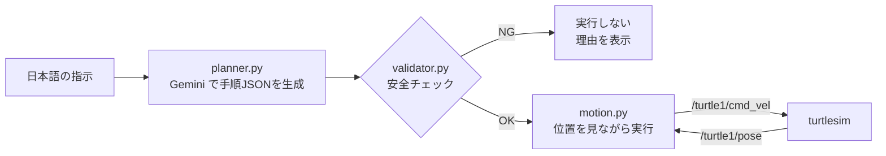

# pai-nl-turtle：日本語の指示でロボットを動かす

日本語で「一辺2mの正方形を描いて」と指示すると、Gemini が動作の手順（JSON）を作り、**バリデータで安全を確認してから** ROS 2 経由で turtlesim の亀を動かします。

Physical AI 応用編1 最終課題の提出物です。

- デモ動画：https://youtu.be/COAbA897g2Q

## 仕組み



1. **planner.py**：指示と亀の現在位置を Gemini に渡し、`forward`（m）と `turn`（度）の手順リストを JSON で受け取る
2. **validator.py**：LLM の出力をそのまま信用せず、次を確認する
   - 形式（種類は `forward` / `turn` のみ、値は有限の数）
   - 範囲（前進・後退は ±5 m、回転は ±360 度、手順は 20 個まで）
   - 現在位置から動きを模擬し、場外（0.5〜10.5 m）に出ないか。出る場合は「あと何 m 進めるか」を表示
   - 値が 0 の手順は、無害なので取り除く
3. **motion.py**：`/turtle1/pose` を見ながら目標の距離・向きに達したら止める（秒数で動かさない）。1つの手順が 15 秒で終わらなければ打ち切る

## 動かし方

必要なもの：Docker（Apple Silicon / x86_64 のどちらでも可）、Gemini API キー（[Google AI Studio](https://aistudio.google.com/apikey) で無料で取得可）

```bash
# 1. APIキーを設定（.env は Git 管理外）
cp .env.example .env
#    .env を開いて GEMINI_API_KEY= の後ろにキーを書く

# 2. ROS 2 環境を起動し、ブラウザで http://localhost:6080 を開く
docker compose up -d

# 3. 亀の窓を出す
scripts/start_turtlesim.sh

# 4. 日本語で指示する（終了は q）
scripts/commander.sh
```

指示の例：

| 指示 | 結果 |
|---|---|
| 一辺2mの正方形を描いて | 正方形を描いて元の位置に戻る |
| 星を描いて | 長さや角度を AI が決めて星形を描く |
| 2m下がって | 後退する |
| まっすぐ8m進んで | 上限（5 m）を超えるので実行しない |

亀を中央に戻して線を消すには `scripts/reset_turtlesim.sh` を実行します。

使うモデルは `.env` の `GEMINI_MODEL` で変えられます（既定は `gemini-3.5-flash-lite`）。

## テスト

バリデータは ROS に依存しない純粋な Python なので、ROS や API キーなしでテストできます。push のたびに GitHub Actions でも実行されます。

```bash
cd ros2_ws/src/nl_turtle
python -m pytest -q test/
```

正しい手順に加え、わざと壊した手順（範囲外の値、未知の種類、場外に出る動き、値が 0 の手順など）で、バリデータが正しく通す・止めることを確かめています。

## ファイル構成

```text
.
├── compose.yaml              # ROS 2 環境（イメージは digest で固定）
├── scripts/                  # 起動・指示・リセット用のスクリプト
├── .github/workflows/        # テストの自動実行
└── ros2_ws/src/nl_turtle/
    ├── nl_turtle/
    │   ├── plan.py           # 手順のデータ型
    │   ├── planner.py        # Gemini 呼び出し
    │   ├── validator.py      # 安全チェック
    │   ├── motion.py         # 手順の実行（ROS 2 ノード）
    │   ├── nl_commander.py   # 指示 → 生成 → 検証 → 実行
    │   └── square_demo.py    # AI なしで正方形を描くデモ
    └── test/test_validator.py
```

## ライセンス

MIT
